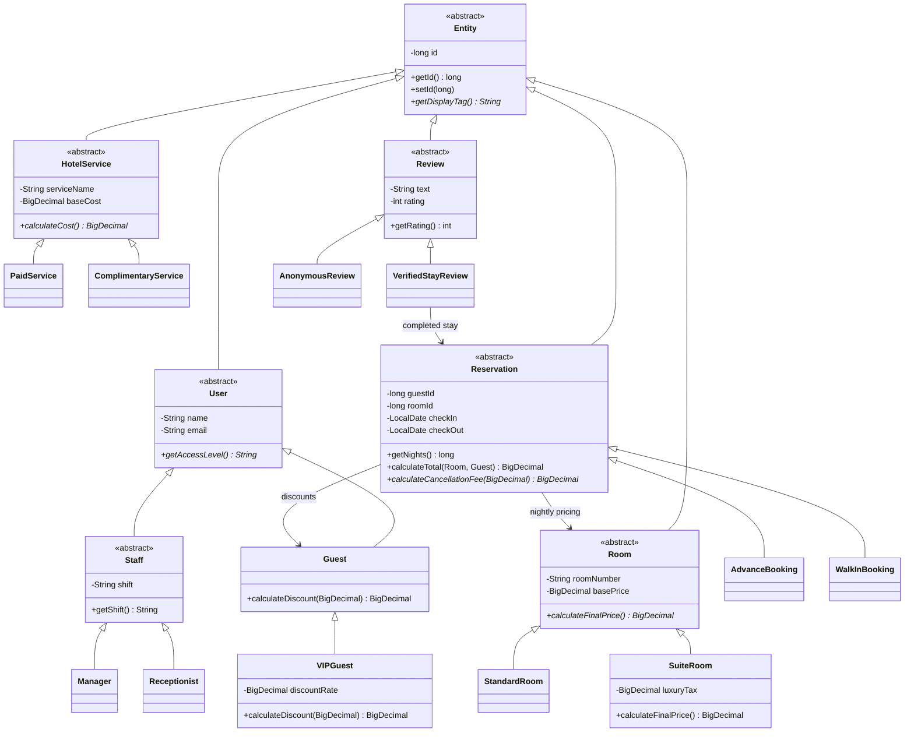
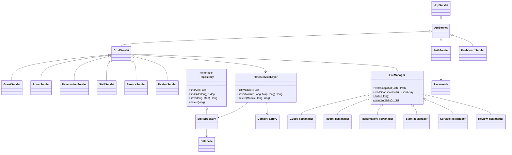
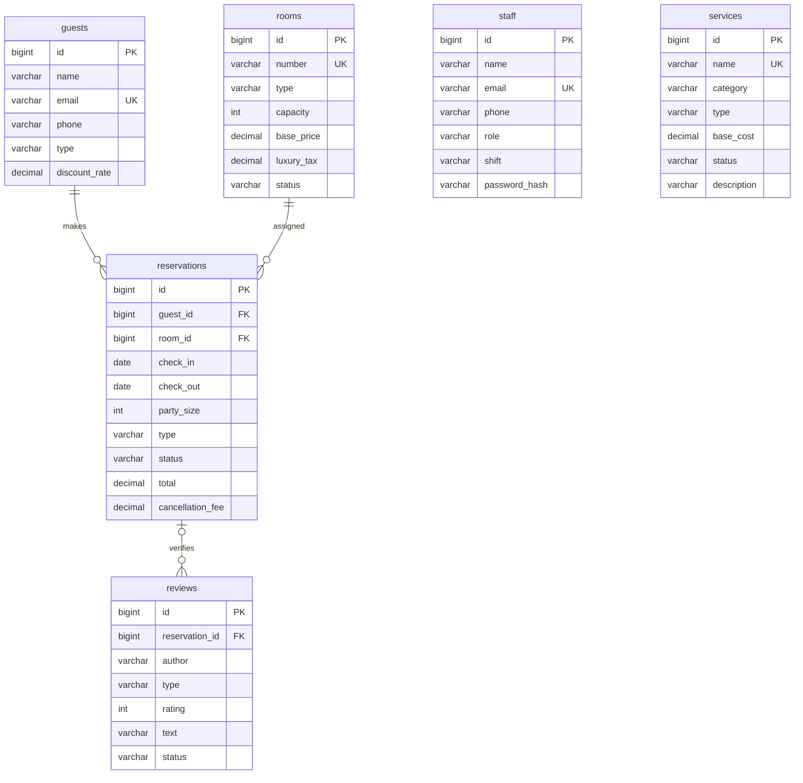

# Class diagrams and database relationships

These Mermaid diagrams render in GitHub and compatible Markdown editors. Package names follow the provided blueprint; SQL repositories replace file-only primary persistence while module FileManagers retain read/write features.

`staff` and `services` are independent operational entities. An anonymous review has a null reservation FK. The database enforces this distinction. The internal `app_metadata` table holds a one-time sample import marker.
